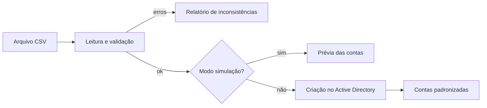

<p align="center">

</p>

<h1 align="center">AD Manager</h1>
<p align="center"><i>Provisionamento automatizado de usuários e contas de serviço no Active Directory</i></p>

<p align="center">


</p>

## Sumário

- [Sobre](#sobre)
- [Problema e solução](#problema-e-solução)
- [Funcionalidades](#funcionalidades)
- [Como funciona](#como-funciona)
- [Tecnologias](#tecnologias)
- [Benefícios](#benefícios)
- [Estrutura do repositório](#estrutura-do-repositório)
- [Autor](#autor)

## Sobre

Solução em **PowerShell** para automatizar a criação de **contas de usuário** e **contas de serviço** no Active Directory. O provisionamento é feito em massa a partir de arquivos **CSV**, com **validações automáticas** e **modo de simulação**, o que reduz atividades manuais e padroniza o processo.

> [!NOTE]
> Projeto desenvolvido em ambiente corporativo. O código-fonte e os dados não são publicados por conterem informações internas; este repositório documenta o problema, a solução e o funcionamento.

## Problema e solução

| | |
| --- | --- |
| **Problema** | Criar contas uma a uma no console do AD é lento, repetitivo e sujeito a erros de digitação e de padrão (nomes, OUs, grupos). |
| **Solução** | Um script que lê a lista de contas em CSV, valida cada linha, simula o resultado antes de aplicar e cria as contas seguindo sempre o mesmo padrão. |

## Funcionalidades

- Provisionamento em massa a partir de arquivo CSV
- Criação de contas de usuário e de contas de serviço
- Validações automáticas antes de qualquer alteração no AD
- Modo de simulação para conferir o resultado sem alterar o ambiente
- Padronização de nomes e atributos das contas

## Como funciona



Detalhes: [Como funciona](docs/como-funciona.md) · [Modelo de CSV](docs/modelo-csv.md)

## Tecnologias

| Tecnologia | Uso no projeto |
| --- | --- |
| PowerShell | Lógica de leitura, validação e criação das contas |
| Active Directory | Destino do provisionamento de usuários e contas de serviço |
| CSV | Entrada padronizada com os dados das contas |

## Benefícios

- Menos atividade manual na criação de contas
- Processo padronizado e repetível
- Mais segurança com a simulação antes da execução

## Estrutura do repositório

```text
ad-manager-powershell/
├── assets/
│   └── capa.png
├── docs/
│   ├── como-funciona.md
│   └── modelo-csv.md
└── README.md
```

## Autor

**Rodrigo Lemes** · Analista de TI · Microsoft 365, AD/Entra ID, Automação, Power BI e IA aplicada

[](https://www.linkedin.com/in/rodrigoalemes/)
[](https://github.com/rodrigoalemes)
